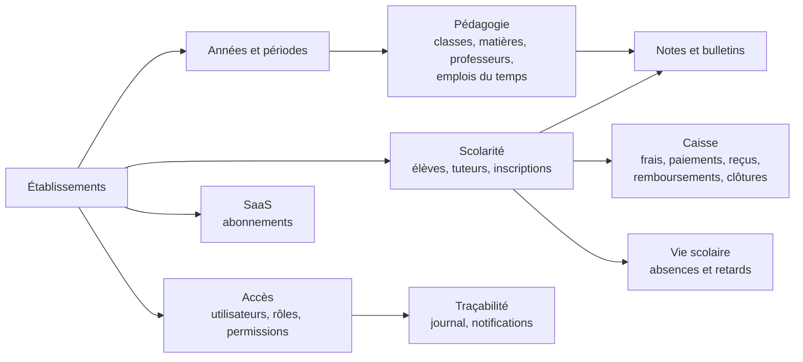
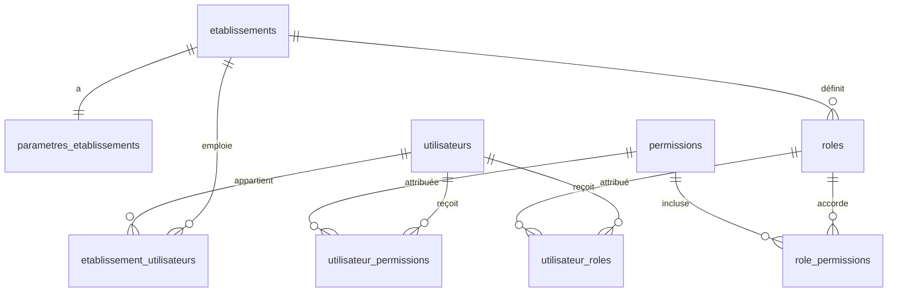
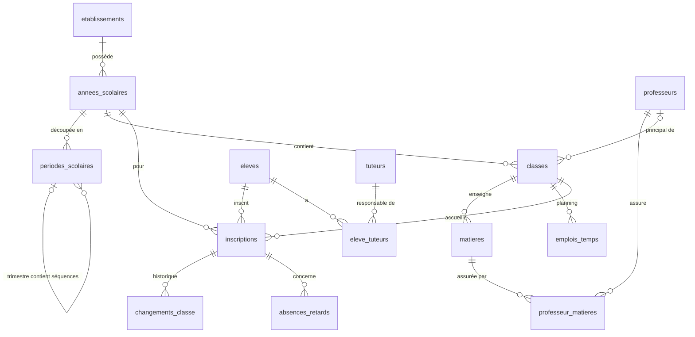
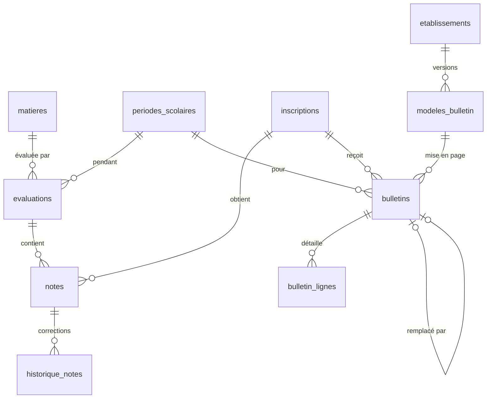
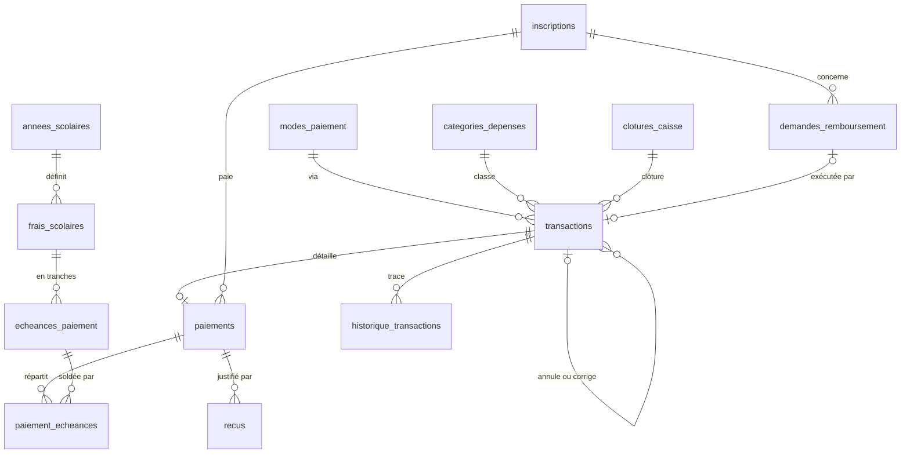
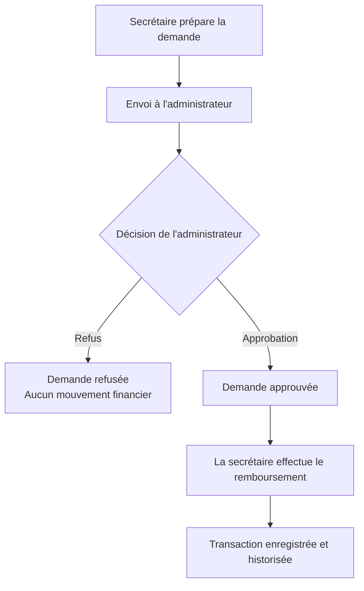
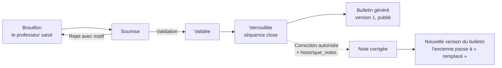

# 0. Fiche du document

| Élément | Description |
|---|---|
| Version | 1.1 — ajout du modèle de bulletin et des bulletins trimestriels (28/11/2026) · 1.0 — audit initial (24/11/2026) |
| Date | 24 novembre 2026 |
| Documents analysés | *Document maître V1.0* et *Documentation de la base de données V1* (copies dans `docs/references/`) |
| Base cible | MySQL 8.0, moteur InnoDB, encodage `utf8mb4` |
| Framework | Laravel 13 (PHP 8.3+) |
| Statut | **Proposition soumise à validation du propriétaire** — aucune migration n'est créée avant accord |

**Règle de lecture.** Chaque modification est présentée avec : le problème constaté, la solution proposée, la justification, et l'impact. Les décisions métier déjà validées par le propriétaire (caisse, circuit de remboursement, matières rattachées à la classe, etc.) sont respectées et ne sont pas remises en cause.

**Décisions du propriétaire intégrées dans cette version (24/11/2026) :**

- Les tables `emplois_temps` et `absences_retards` sont **incluses** dès maintenant.
- **Pas de réductions** sur les frais (bourses, fratrie…) : le reste à payer se calcule uniquement à partir des frais de la classe.
- La documentation du projet est conservée **dans le dépôt Git** (proposition par défaut, voir § 6).

**Décisions du propriétaire intégrées dans la version 1.1 (28/11/2026) :**

- Les bulletins sont produits **uniquement par trimestre** (décision 033). Le bulletin du 3e trimestre contient le bilan de l'année.
- Chaque école règle son bulletin dans la page « Modèle de bulletin » (décision 034). Le modèle est enregistré dans une **nouvelle table versionnée** `modeles_bulletin` (option 1 choisie, décision 035) : chaque bulletin publié garde la version du modèle utilisée.
- La discipline est gérée hors de la plateforme (décision 032) : **aucune table** de sanctions n'est prévue.

# 1. Résumé de l'audit

La structure proposée est **saine dans son découpage** : les domaines (accès, années, scolarité, pédagogie, notes, caisse, suivi, SaaS) sont bien séparés, l'inscription annuelle est distincte du dossier permanent de l'élève, et le circuit de remboursement est bien représenté.

Les corrections portent surtout sur **la sécurité de l'isolation entre écoles**, **la traçabilité** (notes, bulletins, caisse) et **les cas réels de scolarité** (changement de classe en cours d'année, paiements partiels).

| Catégorie | Nombre | Tables |
|---|---|---|
| Tables conservées (colonnes précisées) | 41 | voir § 4 (dont `parametres_etablissements`, cité dans le document maître) |
| Tables ajoutées | 7 | `utilisateur_permissions`, `changements_classe`, `historique_notes`, `bulletin_lignes`, `modeles_bulletin` (v1.1), `paiement_echeances`, `compteurs` |
| Tables techniques Laravel ajoutées | 8 | `sessions`, `password_reset_tokens`, `personal_access_tokens`, `cache`, `cache_locks`, `jobs`, `job_batches`, `failed_jobs` |
| Tables retirées de la base applicative | 6 | tables de documentation → dépôt Git (§ 6) |

## Les 10 constats principaux

| # | Constat | Gravité | Correction |
|---|---|---|---|
| C1 | Une clé étrangère simple ne garantit pas que deux enregistrements liés appartiennent **à la même école** | Critique | Clés étrangères composites `(etablissement_id, id)` + filtre global Laravel |
| C2 | Impossible de donner une permission à **une seule** secrétaire sans créer un rôle par personne | Élevée | Table `utilisateur_permissions` |
| C3 | Rien n'empêche deux années **actives** dans la même école | Élevée | Colonne générée + contrainte unique |
| C4 | Une inscription unique par an ne gère pas le **changement de classe** ni le **départ** en cours d'année | Élevée | Statut et dates sur `inscriptions` + table `changements_classe` |
| C5 | Une note corrigée **écrase** l'ancienne valeur | Élevée | Table `historique_notes` |
| C6 | Un bulletin régénéré peut **changer silencieusement** | Élevée | Versions de bulletin + `bulletin_lignes` figées |
| C7 | Un paiement ne peut pas être **réparti sur plusieurs tranches** | Moyenne | Table `paiement_echeances` |
| C8 | Risque de **doublon** d'une opération Mobile Money et de **numéros de reçus** en double | Moyenne | Référence externe unique + table `compteurs` |
| C9 | Les tables propres à Laravel (sessions, jetons, files) n'apparaissent pas | Moyenne | Ajout des tables techniques |
| C10 | Les tables de documentation mélangent le projet et les **données des écoles clientes** | Faible | Documentation versionnée dans Git |

# 2. Conventions appliquées à toutes les tables

| Convention | Règle | Justification |
|---|---|---|
| Clé primaire | `id BIGINT UNSIGNED AUTO_INCREMENT` | Standard Laravel (`$table->id()`) |
| Appartenance à l'école | `etablissement_id BIGINT UNSIGNED NOT NULL` sur **chaque table métier** | Isolation multi-établissements (contrôle 1) |
| Clé composite d'école | `UNIQUE (etablissement_id, id)` sur chaque table métier référencée | Permet les clés étrangères composites (§ 3.1) |
| Horodatage | `created_at`, `updated_at` | Standard Laravel (`timestamps()`) |
| Suppression logique | `deleted_at` sur les dossiers (élèves, tuteurs, classes, matières…) | Rien n'est détruit depuis l'interface (doc. maître § 6.2) |
| Auteur | `cree_par`, `modifie_par` → `utilisateurs.id` sur les opérations sensibles | Traçabilité (doc. maître § 6.5) |
| Montants | `BIGINT UNSIGNED` en **FCFA entiers** | Le FCFA n'a pas de centimes ; aucun arrondi flottant |
| Notes | `DECIMAL(5,2)` | Valeurs exactes comme 12,75 |
| Énumérations | `VARCHAR(30)` + énumération PHP (`enum` Laravel) | Ajouter une valeur ne demande pas de migration lourde |
| Suppression en cascade | **Interdite** sur les données métier (`ON DELETE RESTRICT`) | Une école, une classe ou un élève avec historique ne peut pas être effacé |
| Noms | Tables et colonnes en **français**, sauf colonnes imposées par Laravel (`password`, `remember_token`…) | Cohérence avec la conception ; Laravel accepte des noms personnalisés |

> **Légende des tableaux de colonnes** — **PK** clé primaire · **FK** clé étrangère · **U** unique · **N** nullable (facultatif) · **I** index. Les colonnes `id`, `created_at`, `updated_at` ne sont répétées que lorsqu'elles ont une particularité.

# 3. Réponses aux 9 contrôles obligatoires

## 3.1 Isolation multi-établissements

**Problème.** Avec une clé étrangère simple, MySQL vérifie seulement que l'élève n° 52 *existe*. Il ne vérifie pas que cet élève appartient à **la même école** que la classe dans laquelle on l'inscrit. Une erreur de programmation ou une requête malveillante pourrait donc mélanger les données de deux écoles.

**Solution — deux protections indépendantes :**

1. **Dans la base (garantie forte).** Chaque table métier possède un index unique `(etablissement_id, id)`. Les tables qui la référencent utilisent une **clé étrangère composite** :

```sql
-- Exemple : une inscription ne peut relier qu'un élève et une classe de la même école
ALTER TABLE inscriptions
  ADD CONSTRAINT fk_inscriptions_eleve
      FOREIGN KEY (etablissement_id, eleve_id)
      REFERENCES eleves (etablissement_id, id),
  ADD CONSTRAINT fk_inscriptions_classe
      FOREIGN KEY (etablissement_id, classe_id)
      REFERENCES classes (etablissement_id, id);
```

   Si `eleve_id` appartient à l'école B alors que l'inscription est dans l'école A, **MySQL refuse l'enregistrement**.

2. **Dans Laravel.** Un *global scope* ajoute automatiquement `WHERE etablissement_id = <école de l'utilisateur>` à toutes les requêtes des modèles métier, et remplit automatiquement `etablissement_id` à la création. Le Super Administrateur est le seul à pouvoir désactiver ce filtre.

**Impact.** Aucun sur les interfaces. Les migrations sont un peu plus longues à écrire.

## 3.2 Rôles et permissions

**Problème.** Le document prévoit `roles`, `permissions`, `role_permissions` et `utilisateur_roles`. Or le propriétaire veut **des permissions personnalisées par secrétaire**. Avec seulement ces tables, il faudrait créer un rôle distinct pour chaque secrétaire.

**Solution.**

- Ajout de `utilisateur_permissions` : permissions accordées **directement** à un utilisateur dans une école.
- Droits effectifs d'un utilisateur = permissions de ses rôles **+** ses permissions directes.
- Le **Super Administrateur** est identifié par `utilisateurs.est_super_admin`. Ce drapeau **ne peut pas** être attribué depuis l'interface d'une école : un administrateur d'école ne peut donc jamais se donner les droits de la plateforme.
- Un administrateur d'école ne peut attribuer que des rôles et permissions **de portée établissement**, et uniquement dans son école.

**Implémentation recommandée.** Le paquet **spatie/laravel-permission** (le plus utilisé pour Laravel) gère exactement ce besoin, avec le mode *teams* où l'équipe = l'établissement. Ses noms de tables sont configurables : on conserve donc **les noms de la conception** (`roles`, `permissions`, `role_permissions`, `utilisateur_roles`, `utilisateur_permissions`).
Référence : documentation spatie/laravel-permission, sections « Teams permissions » et « Direct permissions ».

## 3.3 Années scolaires

**Problème.** MySQL ne propose pas d'index unique partiel (« unique seulement si active »).

**Solution.** Une colonne générée vaut `1` si l'année est active et `NULL` sinon. Comme un index unique accepte plusieurs `NULL`, on obtient « au plus une année active par école » :

```sql
marqueur_active TINYINT GENERATED ALWAYS AS (IF(statut = 'active', 1, NULL)) STORED,
UNIQUE KEY uq_annee_active (etablissement_id, marqueur_active)
```

Les années ne sont jamais supprimées : elles passent par les statuts `preparation → active → cloturee → archivee`.

## 3.4 Scolarité : inscriptions, redoublements, transferts

**Problème.** « Une inscription par élève et par année » est la bonne règle, mais elle ne dit pas ce qui se passe quand l'élève **change de classe** en cours d'année, **quitte** l'école ou est **exclu**.

**Solution.**

- `inscriptions` garde la règle `UNIQUE (eleve_id, annee_scolaire_id)` et reçoit : `statut` (`en_attente`, `active`, `transferee`, `abandon`, `exclue`, `terminee`), `date_inscription`, `date_sortie`, `motif_sortie`, `decision_fin_annee` (`admis`, `redouble`, `exclu`).
- `statut_eleve` (`nouveau`, `ancien`, `redoublant`) reste celui de la conception.
- Nouvelle table `changements_classe` : historique de chaque changement (ancienne classe, nouvelle classe, date, motif, auteur). `inscriptions.classe_id` contient toujours la classe **actuelle**.

## 3.5 Notes et bulletins

**Problèmes.**

1. Une note corrigée remplace l'ancienne valeur : la trace est perdue.
2. Le statut (saisie, soumission, validation) placé sur **chaque note** oblige à valider les notes une par une.
3. Si un bulletin est régénéré après une correction, l'ancien est perdu.

**Solutions.**

- Le **circuit de validation** est porté par `evaluations.statut` : `brouillon → soumise → validee` (ou `rejetee`), puis `verrouillee` quand la séquence est close. Le professeur soumet **toute l'évaluation** d'un coup. Chaque note garde un statut simple (`saisie`, `absent`, `dispense`) pour les cas particuliers.
- Nouvelle table `historique_notes` : ancienne valeur, nouvelle valeur, motif, auteur, date. Toute correction après soumission y est obligatoirement enregistrée.
- `bulletins` reçoit un **numéro de version** et un statut (`brouillon`, `publie`, `remplace`, `annule`). Une correction crée une **nouvelle version** ; l'ancienne passe à `remplace` et reste consultable.
- Nouvelle table `bulletin_lignes` : copie **figée** des moyennes, coefficients et rangs par matière au moment de la génération. Le bulletin reste identique même si une note change plus tard.
- Le fichier PDF est accompagné de son **empreinte SHA-256** pour prouver qu'il n'a pas été modifié.
- *(v1.1)* La mise en page vient de la table `modeles_bulletin` (une ligne par version du modèle de chaque école). `bulletins.modele_bulletin_id` garde la version utilisée : un bulletin publié se réimprime à l'identique même si l'administrateur change le modèle ensuite.
- *(v1.1)* Un bulletin est produit **par trimestre** uniquement ; celui du 3e trimestre porte en plus la moyenne et le rang annuels et la décision de fin d'année.

**Calculs (système camerounais).** Moyenne de séquence par matière → moyenne de trimestre (moyenne des 2 séquences) → moyenne générale pondérée par les coefficients → rang dans la classe (ex æquo gérés). Les barèmes (note maximale, seuil de réussite, appréciations) sont dans `parametres_etablissements`.

## 3.6 Caisse

Le fonctionnement de la caisse est **considéré comme terminé** et n'est pas modifié. Les points ci-dessous concernent uniquement le stockage des données.

| Point | Constat | Solution |
|---|---|---|
| Paiements partiels | Un paiement peut solder une tranche et en entamer une autre | Table `paiement_echeances` : répartition d'un paiement sur une ou plusieurs échéances |
| Doublons Mobile Money | La même opération peut être saisie deux fois | `UNIQUE (etablissement_id, mode_paiement_id, reference_externe)` sur `transactions` |
| Numéros de reçus | Deux secrétaires peuvent obtenir le même numéro en même temps | Table `compteurs`, lue avec un verrou (`SELECT … FOR UPDATE`) |
| Annulations | Un paiement confirmé ne doit pas être supprimé | `transactions` n'est jamais modifiée, sauf son statut ; une annulation crée une **écriture inverse** liée par `transaction_origine_id` |
| Remboursements | La secrétaire ne peut pas exécuter sans approbation | `demandes_remboursement.transaction_id` ne peut être renseigné que si `statut = approuvee` (contrôle applicatif + test automatique) |
| Espèces / électronique | Les soldes doivent être suivis séparément | `modes_paiement.nature` (`especes`/`electronique`) et des colonnes séparées dans `clotures_caisse` |
| Reste à payer | Pas de réductions (décision du 24/11/2026) | Reste à payer = total des échéances de la classe − total affecté dans `paiement_echeances` |
| `historique_transactions` | Peut sembler redondant avec `journal_activites` | **Conservée** comme journal financier dédié (état avant/après), plus simple à auditer que le journal général |

## 3.7 Sécurité

- Mots de passe **hachés** par Laravel (bcrypt ou argon2), jamais stockés en clair.
- Justificatifs, photos et bulletins stockés sur un **disque privé** (hors du dossier public). Téléchargement uniquement via une route qui vérifie les droits.
- Chaque fichier conserve son empreinte SHA-256, son type et sa taille.
- `eleves.informations_medicales` est **chiffrée** dans la base (cast `encrypted` de Laravel).
- Le journal d'activités enregistre l'adresse IP et le navigateur pour les actions sensibles.
- Limitation des tentatives de connexion (*rate limiting*) et désactivation de compte sans suppression.

## 3.8 Performance

- `etablissement_id` est placé **en première position** dans tous les index composites : chaque recherche commence par isoler l'école.
- Index sur les colonnes de filtre de la caisse (`date_operation`, `type`, `mode_paiement_id`, `effectue_par`).
- Les moyennes et rangs sont **calculés une fois** à la génération du bulletin et stockés dans `bulletin_lignes`, au lieu d'être recalculés à chaque affichage.
- Pagination obligatoire sur les listes (élèves, transactions, journal).

## 3.9 Conventions Laravel

- Les noms français sont conservés ; chaque modèle déclare sa table (`protected $table = 'eleves'`).
- La table des utilisateurs s'appelle `utilisateurs` ; la configuration d'authentification est adaptée.
- Les colonnes imposées par Laravel gardent leur nom anglais : `password`, `remember_token`, `email_verified_at`.
- `notifications` suit le format natif de Laravel (identifiant UUID, `data` en JSON) avec en plus `etablissement_id`.

# 4. Modèle de données proposé — tables et colonnes

## 4.1 Plateforme, établissements et accès

### etablissements — *conservée*

| Colonne | Type | Contraintes | Note |
|---|---|---|---|
| code | VARCHAR(20) | U | Identifiant court de l'école (ex. `CSB-YDE`) |
| nom | VARCHAR(150) | | |
| sigle | VARCHAR(30) | N | |
| type | VARCHAR(30) | | `maternelle`, `primaire`, `secondaire_general`, `secondaire_technique`, `complexe` |
| sous_systeme | VARCHAR(20) | | `francophone`, `anglophone`, `bilingue` |
| adresse, ville, region | VARCHAR | N | |
| telephone, email | VARCHAR | N | |
| logo_chemin | VARCHAR(255) | N | Fichier sur disque privé |
| couleur_principale | CHAR(7) | défaut `#1E3A8A` | Couleur de l'école utilisée par l'interface |
| statut | VARCHAR(20) | I | `actif`, `suspendu`, `archive` |
| deleted_at | TIMESTAMP | N | |

### parametres_etablissements — *conservée*

| Colonne | Type | Contraintes | Note |
|---|---|---|---|
| etablissement_id | BIGINT | FK, U | Une ligne par école |
| note_maximale | DECIMAL(5,2) | défaut 20 | |
| seuil_reussite | DECIMAL(5,2) | défaut 10 | |
| prefixe_matricule | VARCHAR(10) | N | |
| prefixe_recu | VARCHAR(10) | N | |
| signature_chemin, cachet_chemin | VARCHAR(255) | N | |
| bareme_appreciations | JSON | | Ex. `[{"min":16,"libelle":"Très bien"}, …]` |
| options | JSON | N | Réglages futurs sans migration |

*(v1.1)* L'ancienne colonne `entete_bulletin` est retirée : l'en-tête et toute la mise en page du bulletin sont dans `modeles_bulletin` (§ 4.4). Le logo, le nom, le signataire et le barème des appréciations restent ici et dans `etablissements` : ils ne sont pas enregistrés deux fois.

### utilisateurs — *conservée*

| Colonne | Type | Contraintes | Note |
|---|---|---|---|
| nom, prenom | VARCHAR(100) | | |
| email | VARCHAR(150) | U, N | |
| telephone | VARCHAR(20) | U, N | Connexion possible par téléphone |
| password | VARCHAR(255) | | Haché |
| est_super_admin | BOOLEAN | défaut 0 | Non modifiable depuis une école |
| statut | VARCHAR(20) | | `actif`, `desactive` |
| photo_chemin | VARCHAR(255) | N | |
| derniere_connexion_at | TIMESTAMP | N | |
| email_verified_at, remember_token | | N | Laravel |
| deleted_at | TIMESTAMP | N | |

Contrainte : au moins un des deux, `email` ou `telephone`.

### etablissement_utilisateurs — *conservée*

| Colonne | Type | Contraintes | Note |
|---|---|---|---|
| etablissement_id | BIGINT | FK | |
| utilisateur_id | BIGINT | FK | |
| type_compte | VARCHAR(20) | | `administrateur`, `secretaire`, `professeur`, `parent` |
| statut | VARCHAR(20) | | `actif`, `desactive` |
| date_debut, date_fin | DATE | N | |
| cree_par | BIGINT | FK N | |

Unique : `(etablissement_id, utilisateur_id, type_compte)`. Un professeur peut ainsi travailler dans **plusieurs écoles**, et une même personne peut être professeur et parent.

### roles — *conservée*

| Colonne | Type | Contraintes | Note |
|---|---|---|---|
| etablissement_id | BIGINT | FK N | `NULL` = rôle modèle de la plateforme |
| code | VARCHAR(50) | | `admin_etablissement`, `secretaire`, `professeur`… |
| nom | VARCHAR(100) | | |
| description | TEXT | N | |
| est_systeme | BOOLEAN | | Non supprimable |

Unique : `(etablissement_id, code)`.

### permissions — *conservée*

| Colonne | Type | Contraintes | Note |
|---|---|---|---|
| code | VARCHAR(100) | U | Ex. `caisse.encaisser`, `notes.valider` |
| module | VARCHAR(50) | I | `eleves`, `notes`, `caisse`… |
| libelle | VARCHAR(150) | | Texte affiché dans l'interface |
| portee | VARCHAR(20) | | `plateforme` ou `etablissement` |

### role_permissions — *conservée*
`role_id` FK, `permission_id` FK — clé primaire `(role_id, permission_id)`.

### utilisateur_roles — *conservée*
`etablissement_id` FK, `utilisateur_id` FK, `role_id` FK, `attribue_par` FK — unique `(etablissement_id, utilisateur_id, role_id)`.

### utilisateur_permissions — **ajoutée** (constat C2)
`etablissement_id` FK, `utilisateur_id` FK, `permission_id` FK, `attribue_par` FK — unique `(etablissement_id, utilisateur_id, permission_id)`.

## 4.2 Années scolaires et organisation pédagogique

### annees_scolaires — *conservée*

| Colonne | Type | Contraintes | Note |
|---|---|---|---|
| etablissement_id | BIGINT | FK | |
| libelle | VARCHAR(20) | | `2026-2027` |
| date_debut, date_fin | DATE | | |
| statut | VARCHAR(20) | | `preparation`, `active`, `cloturee`, `archivee` |
| marqueur_active | TINYINT | générée | Voir § 3.3 |

Uniques : `(etablissement_id, libelle)` et `(etablissement_id, marqueur_active)`.

### periodes_scolaires — *conservée*

| Colonne | Type | Contraintes | Note |
|---|---|---|---|
| etablissement_id, annee_scolaire_id | BIGINT | FK composite | |
| parent_id | BIGINT | FK N | Séquence → son trimestre |
| type | VARCHAR(20) | | `trimestre`, `semestre`, `sequence` |
| numero | TINYINT | | 1 à 6 pour les séquences |
| libelle | VARCHAR(50) | | `Séquence 1`, `1er trimestre` |
| date_debut, date_fin | DATE | N | |
| statut | VARCHAR(20) | | `ouverte`, `saisie_close`, `cloturee` |

Unique : `(annee_scolaire_id, type, numero)`. Structure camerounaise par défaut : 3 trimestres, 2 séquences chacun.

### classes — *conservée*

| Colonne | Type | Contraintes | Note |
|---|---|---|---|
| etablissement_id, annee_scolaire_id | BIGINT | FK composite | |
| nom | VARCHAR(50) | | `4ème A` |
| niveau | VARCHAR(20) | I | `6eme`, `5eme`, `4eme`, `3eme`, `2nde`, `1ere`, `tle` |
| serie | VARCHAR(10) | N | `A`, `C`, `D`, `TI`… |
| salle | VARCHAR(50) | N | |
| capacite | SMALLINT | N | |
| professeur_principal_id | BIGINT | FK composite N | → `professeurs` |
| deleted_at | TIMESTAMP | N | |

Unique : `(etablissement_id, annee_scolaire_id, nom)`.

### matieres — *conservée (rattachée à la classe, choix du propriétaire)*

| Colonne | Type | Contraintes | Note |
|---|---|---|---|
| etablissement_id, classe_id | BIGINT | FK composite | |
| code | VARCHAR(20) | | **Ajout** : `MATH`, `FRAN`… regroupe une même matière entre classes pour les statistiques |
| nom | VARCHAR(100) | | |
| coefficient | DECIMAL(4,2) | | |
| groupe | TINYINT | N | Groupe de matières du bulletin (1er, 2e, 3e groupe) |
| ordre_affichage | SMALLINT | | Ordre sur le bulletin |
| deleted_at | TIMESTAMP | N | |

Unique : `(classe_id, code)`.

### professeurs — *conservée*

| Colonne | Type | Contraintes | Note |
|---|---|---|---|
| etablissement_id, utilisateur_id | BIGINT | FK | |
| matricule | VARCHAR(30) | N | |
| specialite | VARCHAR(100) | N | |
| type_contrat | VARCHAR(20) | | `permanent`, `vacataire` |
| date_embauche | DATE | N | |
| statut | VARCHAR(20) | | `actif`, `inactif` |

Unique : `(etablissement_id, utilisateur_id)`.

### professeur_matieres — *conservée*

| Colonne | Type | Contraintes | Note |
|---|---|---|---|
| etablissement_id, professeur_id, matiere_id | BIGINT | FK composites | |
| date_debut | DATE | | |
| date_fin | DATE | N | Remplacement en cours d'année |
| attribue_par | BIGINT | FK | |

**Modification :** la colonne « année scolaire » est **retirée** car elle se déduit de `matiere → classe → annee_scolaire`. La stocker en double créerait un risque d'incohérence. L'historique reste complet grâce aux dates.

### emplois_temps — *conservée, incluse (décision du 24/11/2026)*

| Colonne | Type | Contraintes | Note |
|---|---|---|---|
| etablissement_id, classe_id, matiere_id | BIGINT | FK composites | |
| professeur_id | BIGINT | FK N | |
| jour_semaine | TINYINT | | 1 = lundi … 6 = samedi |
| heure_debut, heure_fin | TIME | | |
| salle | VARCHAR(50) | N | |

Index : `(etablissement_id, classe_id, jour_semaine)` et `(etablissement_id, professeur_id, jour_semaine)`. Les chevauchements (même classe ou même professeur au même moment) sont refusés par l'application.

## 4.3 Élèves, tuteurs et inscriptions

### tuteurs — *conservée*

| Colonne | Type | Contraintes | Note |
|---|---|---|---|
| etablissement_id | BIGINT | FK | |
| utilisateur_id | BIGINT | FK N | Compte de l'espace parent, si créé |
| nom, prenom | VARCHAR(100) | | |
| telephone | VARCHAR(20) | I | |
| telephone_secondaire, email, profession, adresse | VARCHAR | N | |
| deleted_at | TIMESTAMP | N | |

### eleves — *conservée*

| Colonne | Type | Contraintes | Note |
|---|---|---|---|
| etablissement_id | BIGINT | FK | |
| utilisateur_id | BIGINT | FK N | Compte élève **facultatif** (point non confirmé) |
| matricule | VARCHAR(30) | | |
| nom, prenom | VARCHAR(100) | | |
| sexe | CHAR(1) | | `M`, `F` |
| date_naissance | DATE | | |
| lieu_naissance, nationalite | VARCHAR | N | |
| photo_chemin, adresse | VARCHAR | N | |
| informations_medicales | TEXT | N, chiffrée | Donnée sensible |
| statut | VARCHAR(20) | | `actif`, `ancien`, `transfere`, `exclu` |
| deleted_at | TIMESTAMP | N | |

Unique : `(etablissement_id, matricule)`.

### eleve_tuteurs — *conservée*

| Colonne | Type | Contraintes | Note |
|---|---|---|---|
| etablissement_id, eleve_id, tuteur_id | BIGINT | FK composites | |
| lien | VARCHAR(20) | | `pere`, `mere`, `tuteur`, `autre` |
| est_principal | BOOLEAN | | |
| acces_espace_parent | BOOLEAN | | |

Unique : `(eleve_id, tuteur_id)`. Un seul tuteur principal par élève (colonne générée, même technique qu'au § 3.3).

### inscriptions — *conservée, complétée* (constat C4)

| Colonne | Type | Contraintes | Note |
|---|---|---|---|
| etablissement_id, eleve_id, annee_scolaire_id, classe_id | BIGINT | FK composites | `classe_id` = classe actuelle |
| statut_eleve | VARCHAR(20) | | `nouveau`, `ancien`, `redoublant` |
| statut | VARCHAR(20) | I | `en_attente`, `active`, `transferee`, `abandon`, `exclue`, `terminee` |
| date_inscription | DATE | | |
| date_sortie, motif_sortie | | N | |
| decision_fin_annee | VARCHAR(20) | N | `admis`, `redouble`, `exclu` |
| inscrit_par | BIGINT | FK | |

Unique : `(eleve_id, annee_scolaire_id)`.

### changements_classe — **ajoutée** (constat C4)
`etablissement_id`, `inscription_id`, `ancienne_classe_id`, `nouvelle_classe_id` (FK composites), `date_effet` DATE, `motif` TEXT, `effectue_par` FK.

## 4.4 Évaluations, notes et bulletins

### evaluations — *conservée, circuit de validation ajouté* (§ 3.5)

| Colonne | Type | Contraintes | Note |
|---|---|---|---|
| etablissement_id, matiere_id, periode_id | BIGINT | FK composites | `periode_id` = séquence |
| type | VARCHAR(20) | | `interrogation`, `devoir`, `composition`, `examen`, `autre` |
| libelle | VARCHAR(100) | | |
| date_evaluation | DATE | | |
| note_sur | DECIMAL(5,2) | défaut 20 | Barème |
| poids | DECIMAL(4,2) | défaut 1 | Poids dans la moyenne de séquence |
| statut | VARCHAR(20) | I | `brouillon`, `soumise`, `validee`, `rejetee`, `verrouillee` |
| cree_par, soumise_par, validee_par | BIGINT | FK N | |
| soumise_at, validee_at | TIMESTAMP | N | |
| motif_rejet | TEXT | N | |

### notes — *conservée*

| Colonne | Type | Contraintes | Note |
|---|---|---|---|
| etablissement_id, evaluation_id, inscription_id | BIGINT | FK composites | |
| valeur | DECIMAL(5,2) | N | Entre 0 et `note_sur` |
| statut | VARCHAR(20) | | `saisie`, `absent`, `dispense` |
| appreciation | VARCHAR(255) | N | |
| saisie_par, modifie_par | BIGINT | FK | |

Unique : `(evaluation_id, inscription_id)`.

### historique_notes — **ajoutée** (constat C5)
`etablissement_id`, `note_id` FK, `ancienne_valeur`, `nouvelle_valeur` DECIMAL(5,2) N, `ancien_statut`, `nouveau_statut`, `motif` TEXT, `modifie_par` FK, `created_at`. Table en **ajout seul** : jamais modifiée ni supprimée.

### bulletins — *conservée, versionnée* (constat C6)

| Colonne | Type | Contraintes | Note |
|---|---|---|---|
| etablissement_id, inscription_id, periode_id | BIGINT | FK composites | **Trimestre uniquement** (v1.1, décision 033) |
| classe_id | BIGINT | FK | Classe au moment de la génération |
| version | SMALLINT | | 1, 2, 3… |
| statut | VARCHAR(20) | | `brouillon`, `publie`, `remplace`, `annule` |
| moyenne_generale | DECIMAL(5,2) | N | |
| rang, effectif_classe | SMALLINT | N | |
| moyenne_classe, moyenne_premier, moyenne_dernier | DECIMAL(5,2) | N | |
| moyenne_annuelle | DECIMAL(5,2) | N | *(v1.1)* 3e trimestre seulement |
| rang_annuel | SMALLINT | N | *(v1.1)* 3e trimestre seulement |
| modele_bulletin_id | BIGINT | FK | *(v1.1)* Version du modèle utilisée, jamais modifiée après publication |
| appreciation, decision | VARCHAR | N | |
| observation_professeur_principal | TEXT | N | |
| fichier_chemin | VARCHAR(255) | N | PDF sur disque privé |
| empreinte_sha256 | CHAR(64) | N | |
| genere_par | BIGINT | FK | |
| genere_at, publie_at | TIMESTAMP | N | |
| remplace_par_id | BIGINT | FK N | → nouvelle version |

Unique : `(inscription_id, periode_id, version)`.

### bulletin_lignes — **ajoutée** (constat C6)
`bulletin_id` FK, `matiere_id` FK, `matiere_nom` (copie), `professeur_nom` (copie), `groupe` (copie), `coefficient`, `notes_sequences` (JSON, les 2 notes du trimestre), `moyenne`, `total_pondere`, `rang_matiere`, `moyenne_classe`, `note_min`, `note_max`, `appreciation`. Copie figée : un bulletin publié ne change jamais.

### modeles_bulletin — **ajoutée** (v1.1, décisions 034-035)

Partie fixe du bulletin, réglée par l'administrateur dans la page « Modèle de bulletin ». Chaque enregistrement crée une **nouvelle version** ; les anciennes restent (jamais modifiées ni supprimées).

| Colonne | Type | Contraintes | Note |
|---|---|---|---|
| etablissement_id | BIGINT | FK | Chaque école a son modèle |
| version | SMALLINT | | 1, 2, 3… |
| actif | BOOLEAN | | Une seule version active par école (colonne générée + unique, comme l'année active § 3.3) |
| titre | VARCHAR(100) | | « Bulletin de notes » ; le système ajoute « du 1er trimestre »… |
| entete | JSON | | Pays, devise, ministère, délégations régionale et départementale, en français et en anglais |
| logo_position | VARCHAR(10) | | `gauche`, `centre`, `droite` |
| colonnes | JSON | | Colonnes affichées : enseignant, notes des séquences, total, rang, moyenne de classe, min–max, appréciation |
| regrouper_matieres | BOOLEAN | | Groupes 1, 2, 3 avec sous-totaux |
| afficher_photo, afficher_assiduite | BOOLEAN | | |
| distinctions | JSON | | Ex. `[{"libelle":"Tableau d'honneur","min":12}, …]` |
| titre_visa_parent, titre_professeur_principal | VARCHAR(60) | | Titres des cases de signature |
| pied_page | VARCHAR(150) | N | « Aucun duplicata ne sera délivré » |
| cree_par | BIGINT | FK | Administrateur qui a enregistré cette version |
| created_at | TIMESTAMP | | |

Unique : `(etablissement_id, version)`. Seul l'administrateur de l'école peut créer une version ; chaque enregistrement est aussi noté dans le journal d'activités.

## 4.5 Caisse, paiements et remboursements

### frais_scolaires — *conservée*

| Colonne | Type | Contraintes | Note |
|---|---|---|---|
| etablissement_id, annee_scolaire_id | BIGINT | FK composites | |
| classe_id | BIGINT | FK N | `NULL` = toutes les classes |
| type | VARCHAR(20) | | `inscription`, `scolarite`, `examen`, `dossier`, `ape`, `autre` |
| libelle | VARCHAR(150) | | |
| montant_total | BIGINT UNSIGNED | | FCFA |
| obligatoire | BOOLEAN | | |

### echeances_paiement — *conservée*
`etablissement_id`, `frais_scolaire_id` FK, `numero_tranche` TINYINT, `libelle` (« 1re tranche »), `montant` BIGINT UNSIGNED, `date_limite` DATE. Unique : `(frais_scolaire_id, numero_tranche)`. Règle : la somme des échéances = `montant_total` du frais.

### categories_depenses — *conservée*
`etablissement_id`, `code`, `nom`, `statut`. Unique : `(etablissement_id, code)`.

### modes_paiement — *conservée*
`etablissement_id` (N = mode de la plateforme), `code` (`especes`, `mtn_momo`, `orange_money`, `banque`, `autre`), `libelle`, `nature` (`especes`/`electronique`), `actif`.

### transactions — *conservée, journal financier central*

| Colonne | Type | Contraintes | Note |
|---|---|---|---|
| etablissement_id, annee_scolaire_id | BIGINT | FK composites | |
| numero | VARCHAR(30) | | Numéro séquentiel par école |
| type | VARCHAR(20) | I | `recette`, `depense`, `remboursement`, `ajustement`, `annulation` |
| sens | VARCHAR(10) | | `entree` ou `sortie` |
| montant | BIGINT UNSIGNED | | FCFA, toujours positif |
| mode_paiement_id | BIGINT | FK | |
| categorie_depense_id | BIGINT | FK N | Pour les dépenses |
| reference_externe | VARCHAR(100) | N | N° de transaction Mobile Money / bancaire |
| date_operation | DATETIME | I | |
| libelle, motif | VARCHAR / TEXT | | |
| statut | VARCHAR(20) | | `validee`, `annulee` |
| transaction_origine_id | BIGINT | FK N | Lien vers l'écriture corrigée ou annulée |
| cloture_caisse_id | BIGINT | FK N | |
| effectue_par | BIGINT | FK I | |

Uniques : `(etablissement_id, numero)` et `(etablissement_id, mode_paiement_id, reference_externe)`.

### paiements — *conservée*
`etablissement_id`, `transaction_id` FK **U**, `inscription_id` FK, `montant`, `payeur_nom`, `payeur_telephone`.

### paiement_echeances — **ajoutée** (constat C7)
`paiement_id` FK, `echeance_id` FK, `montant_affecte` BIGINT UNSIGNED. Unique : `(paiement_id, echeance_id)`.

### demandes_remboursement — *conservée*

| Colonne | Type | Contraintes | Note |
|---|---|---|---|
| etablissement_id, inscription_id | BIGINT | FK composites | Élève concerné |
| paiement_id | BIGINT | FK N | Paiement remboursé |
| montant | BIGINT UNSIGNED | | |
| motif | TEXT | | |
| statut | VARCHAR(20) | I | `en_attente`, `approuvee`, `refusee`, `executee`, `annulee` |
| demandee_par | BIGINT | FK | Secrétaire |
| decidee_par, decidee_at, commentaire_decision | | N | Administrateur |
| executee_par, executee_at | | N | |
| transaction_id | BIGINT | FK N | Renseigné **uniquement** après approbation |

### recus — *conservée*
`etablissement_id`, `paiement_id` FK, `numero` (unique par école, séquentiel), `fichier_chemin`, `empreinte_sha256`, `emis_par`, `emis_at`, `nombre_reimpressions`, `statut` (`valide`, `annule`).

### clotures_caisse — *conservée*

| Colonne | Type | Note |
|---|---|---|
| etablissement_id | BIGINT | |
| periode_debut, periode_fin | DATETIME | |
| solde_ouverture_especes, total_entrees_especes, total_sorties_especes, solde_theorique_especes, solde_reel_especes, ecart_especes | BIGINT | Espèces |
| solde_ouverture_electronique, total_entrees_electronique, total_sorties_electronique, solde_theorique_electronique, solde_reel_electronique, ecart_electronique | BIGINT | Mobile Money / banque |
| statut | VARCHAR(20) | `brouillon`, `validee` |
| cloturee_par, validee_par | BIGINT | |
| observations | TEXT | |

Les paramètres détaillés de clôture (fréquence, droits) restent ceux de la conception de la caisse.

### justificatifs — *conservée*
`etablissement_id`, `justifiable_type` + `justifiable_id` (lien vers transaction, demande, absence…), `nom_original`, `chemin`, `type_mime`, `taille_octets`, `empreinte_sha256`, `televerse_par`.

### historique_transactions — *conservée*
`etablissement_id`, `transaction_id` FK, `action` (`creation`, `annulation`, `correction`, `cloture`), `etat_avant` JSON N, `etat_apres` JSON, `motif`, `effectue_par`, `created_at`. Ajout seul.

### compteurs — **ajoutée** (constat C8)
`etablissement_id`, `cle` (`recu`, `transaction`, `matricule`), `annee_scolaire_id` N, `valeur` BIGINT. Unique : `(etablissement_id, cle, annee_scolaire_id)`. Garantit des numéros uniques et sans trou, même avec plusieurs secrétaires en même temps.

## 4.6 Vie scolaire

### absences_retards — *conservée, incluse (décision du 24/11/2026)*

| Colonne | Type | Contraintes | Note |
|---|---|---|---|
| etablissement_id, inscription_id | BIGINT | FK composites | |
| type | VARCHAR(10) | | `absence`, `retard` |
| date_absence | DATE | I | |
| heure_debut, heure_fin | TIME | N | |
| duree_minutes | SMALLINT | N | |
| matiere_id, emploi_temps_id | BIGINT | FK N | |
| motif | TEXT | N | |
| statut | VARCHAR(20) | | `non_justifiee`, `en_attente`, `justifiee` |
| signale_par, traite_par | BIGINT | FK | |

## 4.7 Notifications et traçabilité

### notifications — *conservée, format Laravel*
`id` UUID, `etablissement_id` N, `type`, `notifiable_type`, `notifiable_id`, `data` JSON, `read_at` N.

### journal_activites — *conservée*
`etablissement_id` N, `utilisateur_id` N, `action` (`creation`, `modification`, `suppression`, `restauration`, `approbation`, `desactivation`, `connexion`…), `sujet_type`, `sujet_id`, `description`, `proprietes` JSON (avant/après), `adresse_ip`, `navigateur`, `created_at`. Ajout seul ; index `(etablissement_id, created_at)`.

## 4.8 Abonnements et configuration SaaS

Ces tables servent au module commercial, **activé plus tard**. Elles sont décrites pour figer la structure, mais ne seront créées qu'au moment du module.

| Table | Colonnes principales |
|---|---|
| plans_abonnements | `code` U, `nom`, `prix_mensuel`, `prix_annuel` (FCFA), `limite_eleves`, `limite_utilisateurs`, `modules` JSON, `actif` |
| abonnements | `etablissement_id`, `plan_id`, `statut` (`essai`, `actif`, `expire`, `suspendu`, `resilie`), `date_debut`, `date_fin`, `renouvellement_auto` |
| paiements_abonnements | `etablissement_id`, `abonnement_id`, `montant`, `mode`, `reference_externe`, `date_paiement`, `statut` |
| historique_abonnements | `etablissement_id`, `abonnement_id`, `ancien_plan_id`, `nouveau_plan_id`, `ancien_statut`, `nouveau_statut`, `motif`, `effectue_par`, `created_at` |
| configurations_plateforme | `cle` U, `valeur` JSON, `description`, `modifie_par` |

## 4.9 Tables techniques Laravel — *ajoutées* (constat C9)

`sessions`, `password_reset_tokens`, `personal_access_tokens` (connexion API de React via Sanctum), `cache`, `cache_locks`, `jobs`, `job_batches`, `failed_jobs` (génération des PDF en arrière-plan). Elles sont créées automatiquement par Laravel.

# 5. Schémas Mermaid

Le code source de chaque schéma est aussi disponible séparément dans `docs/schemas/` (fichiers `.mmd`), modifiable et versionné par Git.

## 5.1 Vue d'ensemble des domaines



## 5.2 Accès et établissements



## 5.3 Scolarité et pédagogie



## 5.4 Notes et bulletins



## 5.5 Caisse



## 5.6 Workflow de remboursement (repris du document maître, inchangé)



## 5.7 Cycle de vie d'une évaluation et d'un bulletin (nouveau)



# 6. Documentation du projet : base de données ou Git ?

**Problème.** Les tables `documents_projet`, `chapitres_projet`, `schemas_mermaid`, `decisions_projet`, `historique_modifications_projet` et `sources_techniques` stockeraient la documentation **du projet FRANCK SCHOOL** dans la même base que les **données des écoles clientes**.

**Proposition : la documentation vit dans le dépôt Git, dossier `docs/`.**

| Critère | Base applicative | Dépôt Git (`docs/`) |
|---|---|---|
| Versions | À programmer soi-même | Automatique, chaque version est conservée |
| Date, auteur, motif | Colonnes à remplir | Fournis par chaque commit |
| Comparer deux versions | À développer | Intégré (GitHub montre les différences) |
| Code Mermaid modifiable | Oui | Oui (fichiers `.mmd`) |
| Risque pour les écoles clientes | Mélange avec leurs données, sauvegardes alourdies | Aucun |
| Coût de développement | 6 tables + écrans | Nul |

**Organisation retenue :**

```
docs/
├── README.md                     → index de la documentation
├── references/                   → documents fournis par le propriétaire (PDF)
├── base-de-donnees/
│   └── audit-bd-v1.md            → ce rapport (source modifiable)
├── schemas/                      → code source Mermaid (.mmd)
├── decisions/
│   └── journal-des-decisions.md  → décisions, date, motif, statut
└── pdf/                          → versions PDF générées
```

Si plus tard le propriétaire veut consulter ces documents depuis l'interface Super Administrateur, une **copie en lecture seule** pourra être ajoutée sans changer cette organisation.

# 7. Impact sur ce qui existe déjà

- Le squelette Laravel déjà installé contient une colonne `role` ajoutée aux utilisateurs. Elle sera **remplacée** par le modèle de rôles et permissions décrit ici. Aucune donnée réelle n'existe encore : aucun risque.
- Laravel 13 demande **PHP 8.3 ou plus**. La version de PHP de WampServer devra être vérifiée sur le poste de développement.
- Aucune interface n'est encore liée à la base : les écrans React peuvent être construits en parallèle avec des données d'exemple.

# 8. Décisions à valider par le propriétaire

| # | Décision proposée | Section |
|---|---|---|
| D1 | Clés étrangères composites pour l'isolation des écoles | 3.1 |
| D2 | Ajout de `utilisateur_permissions` et utilisation de spatie/laravel-permission | 3.2 |
| D3 | Circuit de validation porté par l'évaluation (et non note par note) | 3.5 |
| D4 | Versions de bulletins et `bulletin_lignes` figées | 3.5 |
| D5 | Ajout de `changements_classe`, `historique_notes`, `paiement_echeances`, `compteurs` | 3.4 à 3.6 |
| D6 | Retrait de la colonne année de `professeur_matieres` | 4.2 |
| D7 | Ajout du champ `code` dans `matieres` | 4.2 |
| D8 | Documentation dans Git plutôt qu'en base | 6 |
| D9 | Tables SaaS créées seulement à l'activation du module commercial | 4.8 |
| D10 | *(v1.1)* Table versionnée `modeles_bulletin` et bulletins par trimestre uniquement — **choisie par le propriétaire le 28/11/2026** (option 1) | 3.5, 4.4 |

Après validation, les livrables suivants seront produits : migrations Laravel, modèles et relations, données de départ (rôles, permissions, structure camerounaise des séquences), et tests automatiques des règles critiques (isolation des écoles, année active unique, circuit de remboursement, versions de bulletins).
